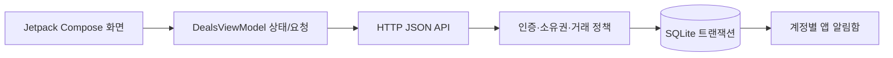

# 저녁득템

주변 매장의 마감 음식을 예약하고 직접 수령하는 **Android 네이티브 포트폴리오 MVP**입니다. 첨부 기획서·화면정의서의 고객/매장 흐름을 Kotlin + Jetpack Compose와 Python/SQLite API로 구현했습니다. 모든 매장과 상품은 가상이며, 결제는 테스트 시뮬레이션입니다.

## 실행

Android Studio에서 이 폴더를 열고 Gradle Sync 후 `app`을 실행하세요. JDK 17 이상, Android SDK 35가 필요하며 Android 8.0(API 26) 이상을 지원합니다.

```bash
# 별도 터미널: Python 3.11 이상, pip 패키지 불필요
python3 server/server.py

# Android 에뮬레이터 기본 주소: http://10.0.2.2:8080
./gradlew assembleDebug
# USB 실기기: adb reverse 후 빌드
adb reverse tcp:8080 tcp:8080
./gradlew assembleDebug -PapiUrl=http://127.0.0.1:8080
adb install -r app/build/outputs/apk/debug/app-debug.apk
```

같은 LAN의 실제 기기에서는 `HOST=0.0.0.0 python3 server/server.py`로 실행하고 `-PapiUrl=http://서버의LAN주소:8080`으로 빌드합니다. 기본 서버 바인딩은 loopback입니다. HTTP는 debug 빌드에서만 허용되며 외부 배포 시 HTTPS API와 배포용 서명이 필요합니다. 데모 API를 인터넷에 그대로 노출하지 마세요.

클라우드 환경은 `bash scripts/cloud-setup.sh`, 이후 터미널마다 `source scripts/env.sh`를 사용합니다. 환경별 SDK·JDK·캐시·신뢰 저장소는 `/workspace` 아래에 두며 시스템 파일을 수정하지 않습니다. Gradle Wrapper와 공식 배포 체크섬으로 도구를 검증합니다.

## 데모 계정

|역할|이메일|비밀번호|
|---|---|---|
|고객|customer@demo.kr|Demo1234!|
|온기 베이커리 운영자|store@demo.kr|Demo1234!|

앱은 비회원 발견 화면에서 시작합니다. 보호 동작을 누를 때만 로그인 안내가 열리며, 로그인 후 선택 화면으로 돌아옵니다. **자동 예약·자동 찜은 하지 않습니다.** 회원가입은 고객만 생성하며 운영자 역할은 서버 seed로만 부여합니다.

## 구현 범위

- **DG-01~03** 발견, 검색, 카테고리·지역·할인가 필터, 마감 임박순, 상세, 지도 앱 열기, 품절·빈 결과·통신 오류
- **DG-04~06** 1~5개 수량 선택, 5분 재고 선점과 만료 타이머, 정책 동의, 테스트 결제 성공/실패/응답 지연, 실제 토큰을 담은 QR과 8자리 코드, 정책 내 취소
- **DG-07~08·11~12·20** 상태별 픽업내역, 매장 단위 찜, 회원/비회원 마이, 완료 거래 1회 후기(별점 1~5, 10~500자)
- **DG-09~10·14~15** 소유 매장 상품 등록·수정·판매 중지, 코드 조회와 별도 수령 확정, 버전 검사. 고객에게 수령 완료 버튼 없음
- **DG-13·16·18** 이메일 로그인, 회원가입, 필수 동의, 로그인 안내, 로그아웃, 만료 세션 처리
- **DG-22~23** 알림 그룹 설정, 거래 이벤트 기반 앱 알림함, 읽음, 계정별 접근. 거래와 알림함은 같은 DB 트랜잭션으로 저장

### 외부 설정·후속 구현이 필요한 항목

Google/Credential Manager, 카카오 SDK, Apple 인증 콜백과 DG-21 소셜 가입 완료는 미연동입니다. 버튼은 준비 중임을 안내하며 인증 성공을 흉내내지 않습니다. OAuth 앱 등록, 키, HTTPS 인증 서버가 필요합니다.

DG-17 메일 발송·DG-19 재설정 토큰 교환은 미구현이며 요청 시 미설정 안내를 반환합니다. FCM 기기 등록·OS 푸시·시각별 예약 발송/outbox 재시도 역시 후속 작업입니다. 현재 알림 설정은 저장되지만 앱 알림함만 생성되며 기기 푸시는 발송되지 않습니다. 따라서 알림 권한을 강제 요청하지 않습니다.

사진 업로드 대신 기본 사진을 사용하고 QR **표시**는 구현했으며 직원 입력은 **숫자 코드**를 지원합니다. 카메라 스캔·정밀 위치·반경/거리 정렬은 후속 구현입니다. 샘플 지역은 성수동이며 다른 지역은 정상 빈 결과를 표시합니다. 샘플 사진 3장은 APK에 포함되어 오프라인에서도 표시됩니다. Unsplash의 설명용 예시이며 실제 매장과 무관합니다. 출처는 `docs/ASSETS.md`에 기록했습니다. 다른 원격 이미지가 실패하면 같은 비율의 대체 화면을 표시합니다.

이 저장소는 데모용입니다. 운영 배포를 위한 인증 시도 제한·메일 검증·감사/보안 운영·실제 결제/정산·수평 확장·소셜/푸시 검수는 포함하지 않습니다.

## 서버와 시간 정책

서버가 UTC epoch 초로 저장하고 앱이 한국 시각으로 표시합니다. 앱은 `/health`의 서버 시각으로 오프셋을 보정해 선점 카운트다운을 표시하며, 최종 거래 판단은 서버만 합니다.

- `BEGIN IMMEDIATE`로 선점·주문·취소·수령 쓰기를 직렬화합니다. 판매 가능 = 총수량 − 확정 수량 − 유효 선점 수량
- 선점 만료는 5분 또는 픽업 종료 중 빠른 시점입니다. 만료된 선점은 수량 계산에서 제외됩니다.
- 요청 키는 사용자+작업별 고유하며 동일 본문 재시도는 기존 응답, 다른 본문은 `REQUEST_KEY_REUSED`로 거절합니다.
- 성공 결제 후 주문·선점·알림을 함께 커밋합니다. 실패 결제는 선점을 해제합니다. 응답 지연 시 이미 커밋된 주문을 같은 키로 재조회합니다.
- 픽업 시작 이상/종료 미만에만 매장 소유자가 수령을 확정할 수 있습니다. 검증은 읽기 전용이고 수령 상태 변경은 별도 호출입니다.
- 취소는 시작 30분 전 **미만**까지 가능합니다. 종료 이후 미수령 전환은 API 요청 시 지연 정리하며 자동 재판매하지 않습니다.
- 비밀번호는 PBKDF2-SHA256(200,000회)+사용자별 salt로 저장합니다. 세션은 7일 만료이며 로그아웃 시 폐기합니다. 토큰·비밀번호·픽업 코드를 요청 로그에 출력하지 않습니다.

## 시연 순서

1. 비회원 발견 → 상품 상세 → 수량 선택 → 로그인 → 수량 선점 → 정책 동의 → 테스트 예약 확정 → 픽업 코드.
2. 내역에서 대기/완료/취소/미수령을 확인합니다. 취소 마감 전에는 취소 후 재고 반환을 확인할 수 있습니다.
3. 매장 계정으로 로그인 → 매장 관리 → 코드 확인 → 숫자 코드 입력 → 상품/수량 확인 → 수령 확정.
4. 고객으로 다시 로그인 → 완료 내역 → 후기 작성.

샘플 데이터는 한국 시각 오늘 19시(이미 지났다면 다음날)로 생성됩니다. 서버 시작 시 기존 상품이 모두 마감됐다면 새 날짜의 샘플 3개를 추가하며, 과거 예약과 상품은 유지합니다. **픽업 시간 전에는 매장 확인이 거절되는 것이 정상입니다.** 기다리지 않고 시연하려면 매장 계정에서 현재 시각을 포함하는 새 상품을 먼저 등록한 뒤 해당 상품으로 예약하세요. 날짜/시간 입력은 한국 시각입니다.

## 데이터와 검증

기본 DB는 `server/deals.db`(Git 제외)입니다. 서버 재시작 뒤에도 계정·예약·찜·후기·알림을 유지합니다. 독립 데이터는 `DEALS_DB=/tmp/별도.db python3 server/server.py`로 지정합니다. 초기화는 **서버 종료 → 기존 DB 백업 → 해당 DB 파일 삭제 → 서버 재실행** 순서입니다.

```bash
(cd server && python3 -m unittest -v)
./gradlew assembleDebug lintDebug
```

`server/test_server.py`는 마지막 재고 동시 선점, 요청 재시도와 본문 충돌, 만료·결제 실패 복원, 소유권·비회원 차단, 수령 1회와 후기 중복, 취소 기한·미수령, 코드 실패 제한, 역할 상승 차단, 재시작 영속성·상품 변경 제한을 검증합니다. `docs/VALIDATION.md`에 이번 실행 결과와 미검증 항목을 기록합니다.

## 구조



앱의 거래 원본은 서버입니다. Compose에 표시되는 재고와 가격은 조회 스냅샷이며 서버가 쓰기 시 다시 검사합니다. APK에 서버 키나 비밀번호를 넣지 않습니다. 샘플 계정 정보는 데모 안내에만 사용됩니다.
