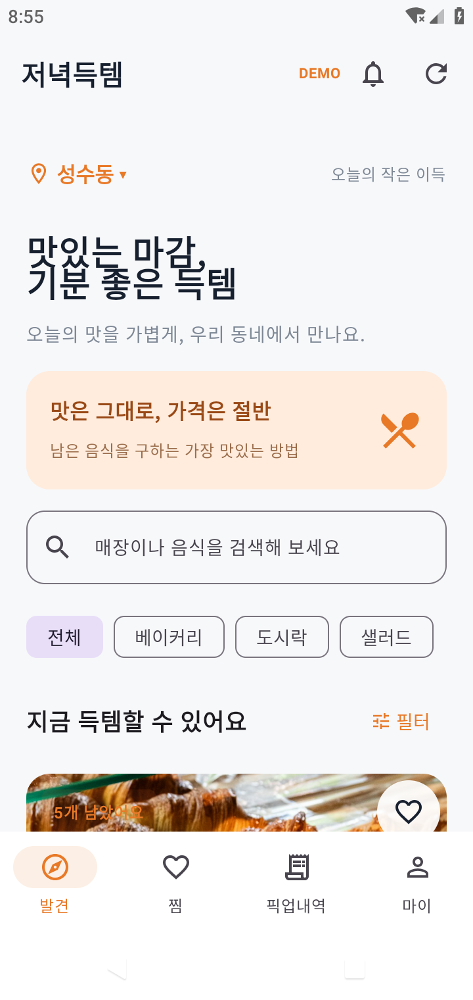
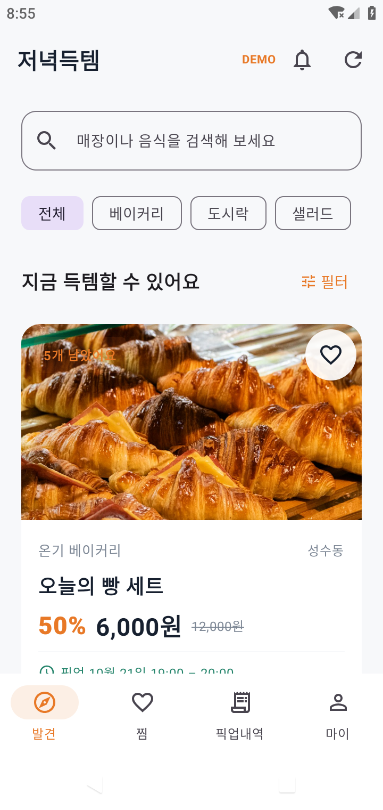
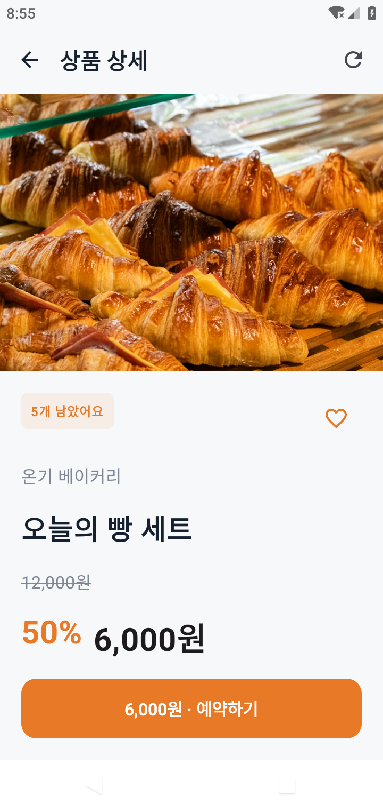
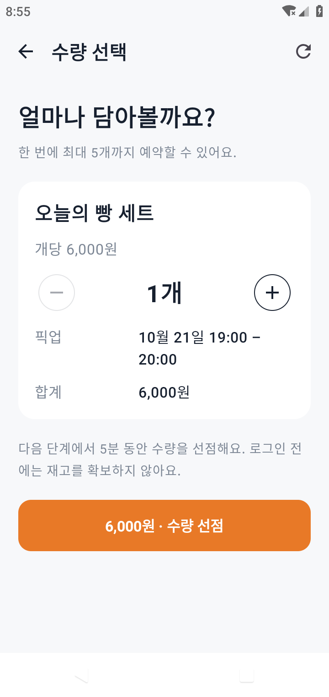
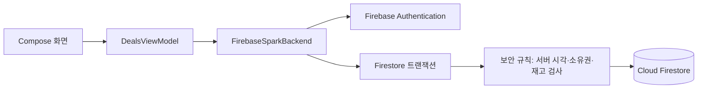

# 저녁득템

주변 매장의 마감 음식을 예약하고 직접 수령하는 Kotlin·Jetpack Compose Android MVP입니다. **기본 백엔드는 Firebase Spark 기준의 Authentication + Cloud Firestore**이며, 별도 Python 서버나 Cloud Functions 없이 동작하도록 전환했습니다. 거래는 실제 과금 없는 테스트 예약입니다.

## Firebase 프로젝트 연결

1. Firebase에서 Spark 프로젝트를 만들고 Android 패키지 **`kr.evening.deals`**를 등록합니다.
2. 받은 `google-services.json`을 **`app/google-services.json`**에 둡니다. Git에서는 제외됩니다.
3. 이메일/비밀번호 로그인을 활성화하고 Firestore `(default)` 데이터베이스를 프로덕션 모드로 생성합니다.
4. `firebase/firestore.rules`와 `firebase/firestore.indexes.json`을 실제 프로젝트에 배포합니다.
5. Android Studio에서 프로젝트를 열어 Sync 및 실행합니다. JDK 17 이상, Android SDK 35, Android 8.0(API 26) 이상을 지원합니다.

```bash
npm ci
npx firebase login
npx firebase deploy --only firestore:rules,firestore:indexes --project YOUR_PROJECT_ID
./gradlew assembleDebug
```

실제 Firebase 설정 파일이 있으면 debug도 실제 프로젝트를 사용합니다. 없으면 로컬 에뮬레이터를 기본으로 사용합니다. 이 코드가 프로젝트 생성·배포·Blaze 업그레이드를 자동 수행하지는 않습니다.

**[프로젝트 설정·운영자 권한·Spark 제약·보안 구조 안내](docs/FIREBASE_SPARK.md)**

## 로컬 개발

```bash
npm ci
# 이 클라우드에서만 필요한 JDK/SDK·캐시 경로
source scripts/env.sh
source firebase/dev-env.sh
npm run firebase:start       # Auth 9099 + Firestore 8085
```

별도 터미널에서:

```bash
source firebase/dev-env.sh
npm run firebase:seed
./gradlew assembleDebug -PfirebaseEmulators=true
```

Android 에뮬레이터는 `10.0.2.2:9099/8085`에 연결합니다. 로컬 전용 계정은 고객 `customer@demo.kr`, 운영자 `store@demo.kr`, 비밀번호 `Demo1234!`입니다. **이 계정과 샘플 데이터는 실제 프로젝트에 자동 생성되지 않습니다.** 운영자 권한은 콘솔에서 `merchants/{Auth UID}`의 `store_id`로 지정합니다.

## 실제 실행 화면

아래는 기존 데모 APK의 Android 9(API 28) 실행 캡처입니다. 화면 구성은 유지하며, Firebase 거래 검증은 별도의 테스트 기록으로 구분합니다.

| 홈 | 상품 목록 |
|---|---|
|  |  |

| 상품 상세 | 수량 선택 |
|---|---|
|  |  |

## 구현 흐름

비회원 탐색 → 이메일 가입/로그인 → 수량 선점 → 테스트 예약 → 픽업 코드 → 매장 코드 검증 → 별도 수령 확정 → 후기 작성. 로그인 복귀 시 거래를 자동 실행하지 않습니다.

- Firestore 원자적 트랜잭션과 보안 규칙으로 재고·가격 스냅샷·소유권을 검사합니다.
- 재고 슬롯 선점, 최대 5분 만료, 동일 요청 확정 중복 방지, 정책 내 취소, 매장 수령 1회 처리를 제공합니다.
- 찜·회원/비회원 마이·상태별 내역·거래당 후기·알림 그룹 설정을 저장합니다.
- 고객에게 수령 완료 버튼을 제공하지 않으며 운영자 권한을 가입 화면에서 선택할 수 없습니다.
- 음식 사진은 APK에 포함하며 출처는 [ASSETS.md](docs/ASSETS.md)에 기록했습니다.

Spark 버전은 **상품당 재고 99개, 목록 20개/주문 30개**, 등록 후 총수량 고정 및 선점 이력 상품의 구성·시간·가격 잠금을 적용합니다. 미수령은 조회 시 지연 처리합니다. 앱 알림함은 거래의 현재 상태를 표시하며 예약 푸시·독립 알림 이벤트/읽음 동기화는 제공하지 않습니다.

실결제·Cloud Storage 업로드·FCM 발송·예약 작업·소셜 로그인·카메라 QR 스캔은 연결하지 않았습니다. 이메일 비밀번호 재설정은 Firebase Auth와 Firebase 호스팅 링크를 사용합니다.

## 검증

```bash
source firebase/dev-env.sh
npm run test:firebase
./gradlew assembleDebug lintDebug
# Auth/Firestore 에뮬레이터와 seed 준비 후, Android 기기를 연결한 상태
./gradlew connectedDebugAndroidTest
```

검증 범위와 결과는 [VALIDATION.md](docs/VALIDATION.md)를 확인하세요. 로컬 에뮬레이터 통과와 실제 Spark 프로젝트 연결·배포는 별도입니다.

## 구조



기존 Python/SQLite API는 회귀 검증과 비교용으로 `server/`에 보존했습니다. `python3 server/server.py`와 `./gradlew assembleDebug -Pbackend=legacy`를 함께 사용하면 이전 경로를 실행할 수 있습니다. Firebase가 기본이며 실제 Firebase 사용에는 Python 서버가 필요 없습니다.
